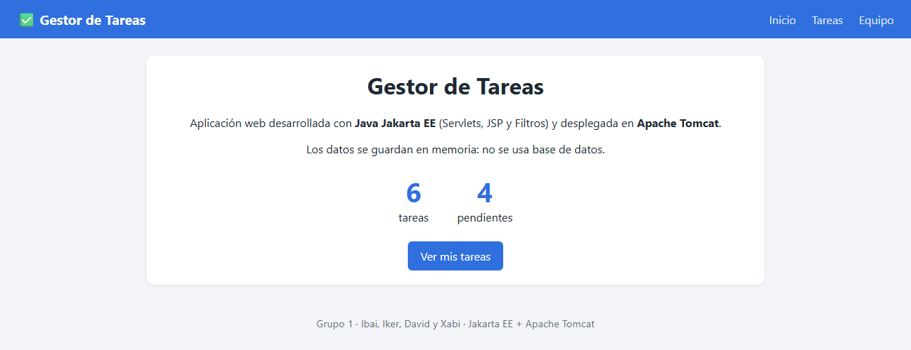
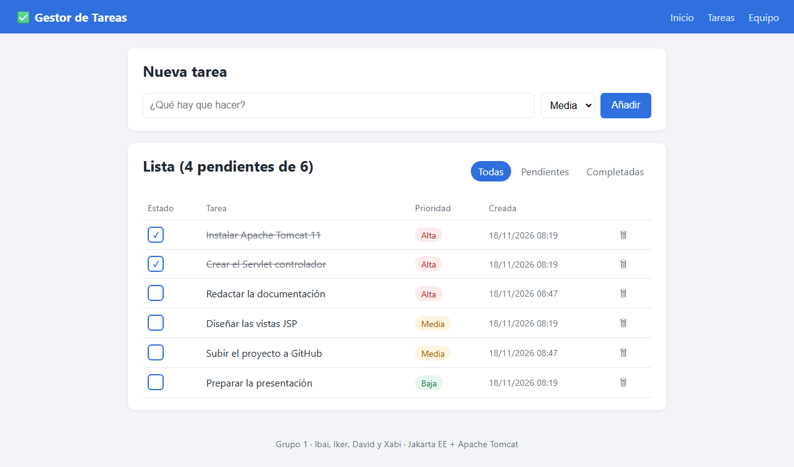
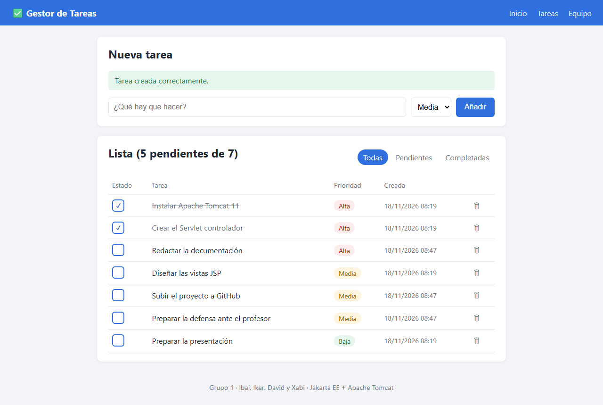
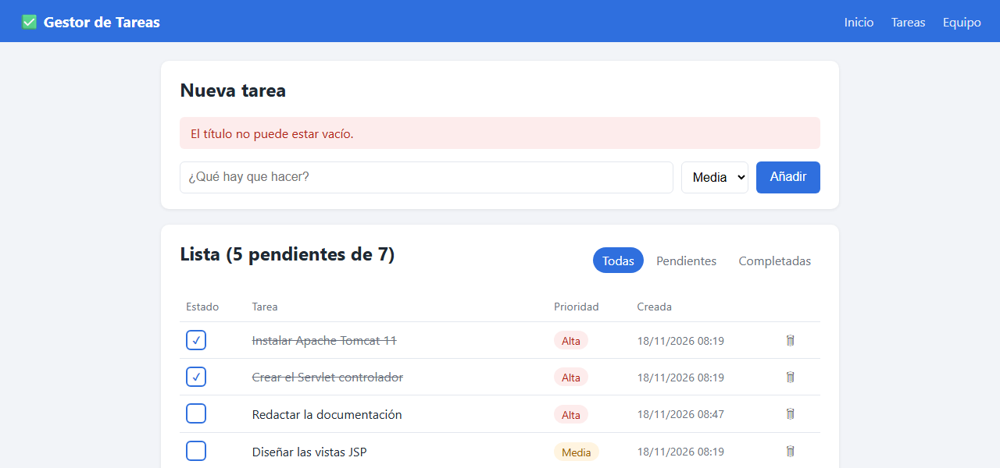
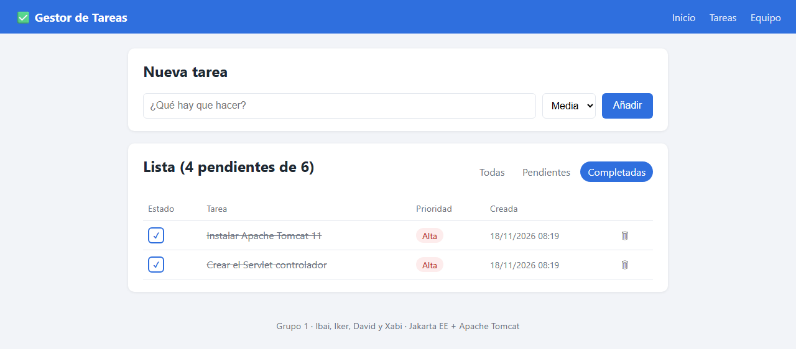
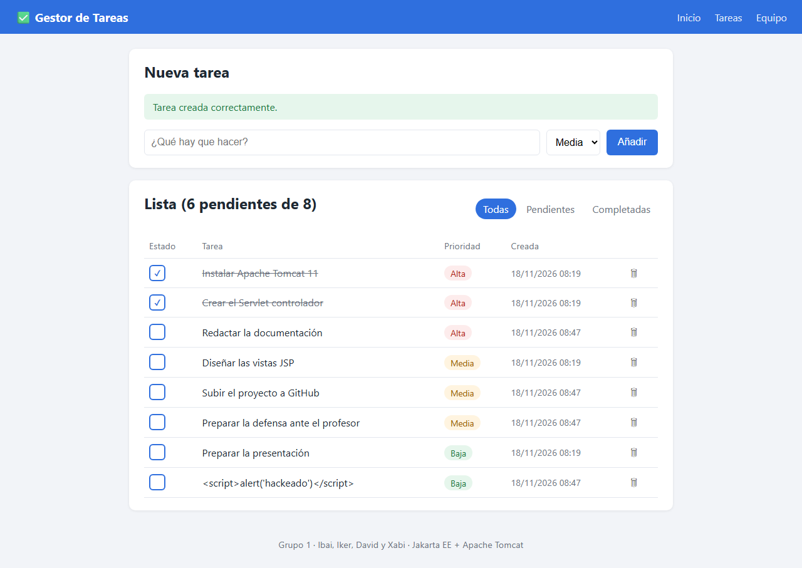
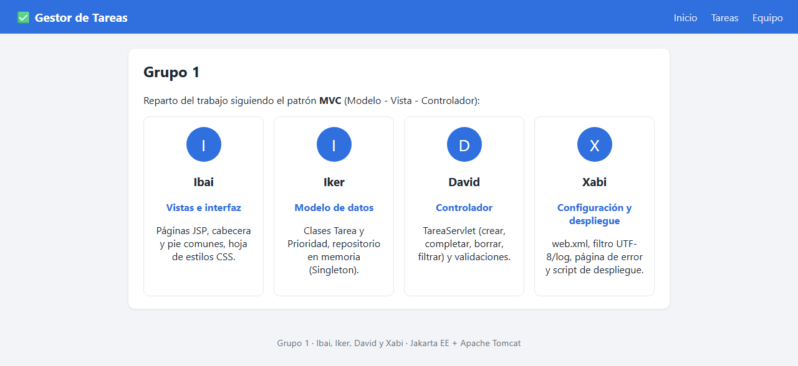
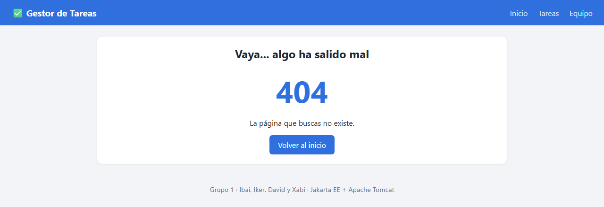

# Documentación · Gestor de Tareas (Grupo 1)

**Integrantes:** Ibai García, Iker Murias, David San Martín y Xabi De Fuentes
**Tecnologías:** Java 23, Jakarta EE (Servlets 6, JSP y Filtros), Apache Tomcat 11.0.26
**Repositorio:** <https://github.com/xabidefuentes/grupo1-gestor-tareas>

## 1. Objetivo

El objetivo era desarrollar una aplicación web sencilla con Java Jakarta EE y desplegarla en Apache Tomcat.
Hemos hecho un **gestor de tareas**: permite crear tareas, completarlas, borrarlas y filtrarlas.
Los datos se guardan en memoria, sin base de datos.

## 2. Arquitectura (MVC) y reparto

| Capa | Clase / fichero | Responsable |
|------|-----------------|-------------|
| Modelo | `Tarea`, `Prioridad`, `RepositorioTareas` (almacena las tareas en memoria; Singleton) | Iker |
| Controlador | `TareaServlet` (`@WebServlet("/tareas")`), `Html` (escapa el HTML) | David |
| Vista | `index.jsp`, `tareas.jsp`, `equipo.jsp`, CSS | Ibai |
| Configuración | `web.xml`, `RegistroFiltro` (`@WebFilter`), `error.jsp`, `desplegar.bat` | Xabi |

```
Navegador ─► RegistroFiltro ─► TareaServlet ─► RepositorioTareas
              (UTF-8 + log)          │
                                     ▼
                                 tareas.jsp ─► HTML al navegador
```

## 3. Despliegue en Tomcat

1. Ejecutamos `desplegar.bat`. Compila las clases y copia la aplicación a `webapps\grupo1`. Esta es la salida real:

```
[1/3] Limpiando despliegue anterior...
[2/3] Copiando ficheros web...
[3/3] Compilando clases Java...

Desplegado correctamente.
Arranca Tomcat y abre: http://localhost:8080/grupo1/
```

2. Arrancamos Tomcat con `bin\levantar_tomcat.bat`. Tomcat detecta la aplicación y la despliega (extracto de `logs\catalina.log`):

```
INFO [Catalina-utility-2] HostConfig.deployDirectory Desplegando el directorio [...\webapps\grupo1] de la aplicación web
INFO [Catalina-utility-2] HostConfig.deployDirectory Deployment of web application directory [...\webapps\grupo1] has finished in [110] ms
```

3. Abrimos <http://localhost:8080/grupo1/> en el navegador.

## 4. Pruebas de funcionamiento (capturas reales)

### 4.1 Página de inicio
Muestra un resumen calculado en el momento a partir de los datos en memoria.



### 4.2 Lista de tareas
`TareaServlet` (GET) obtiene las tareas del repositorio y las pasa a `tareas.jsp`. Las tareas se ordenan por prioridad y las completadas aparecen tachadas.



### 4.3 Crear una tarea
El formulario envía un POST. El Servlet crea la tarea y redirige a la lista (patrón Post-Redirect-Get), que muestra un mensaje de confirmación.



### 4.4 Validación en el servidor
Si el título está vacío (o pasa de 80 caracteres), el Servlet no crea la tarea y muestra un error.



### 4.5 Filtro de tareas completadas
El parámetro `?filtro=completadas` muestra solo las tareas terminadas.



### 4.6 Seguridad: protección contra XSS
Creamos una tarea con el título `<script>alert('hackeado')</script>`. La clase `Html.escapar()` lo convierte en texto, así que aparece en la lista y no se ejecuta.



### 4.7 Página del equipo



### 4.8 Página de error personalizada (404)
Está configurada en `web.xml` con `<error-page>`.



### 4.9 Log de peticiones
`RegistroFiltro` escribe cada petición y su duración en `logs\localhost.log` (extracto real):

```
INFO [http-nio-8080-exec-13] ApplicationContext.log [Grupo1] GET /grupo1/tareas (0 ms)
INFO [http-nio-8080-exec-18] ApplicationContext.log [Grupo1] GET /grupo1/equipo.jsp (2 ms)
INFO [http-nio-8080-exec-13] ApplicationContext.log [Grupo1] GET /grupo1/pagina-que-no-existe (0 ms)
```

## 5. Conclusión

La aplicación se compila y se despliega en Apache Tomcat 11, y todas sus funcionalidades funcionan como se ve en las capturas.
Al estar organizada en capas (MVC), cada miembro del grupo pudo encargarse de una parte por separado.
Como no usa base de datos, las tareas se pierden al reiniciar Tomcat.
